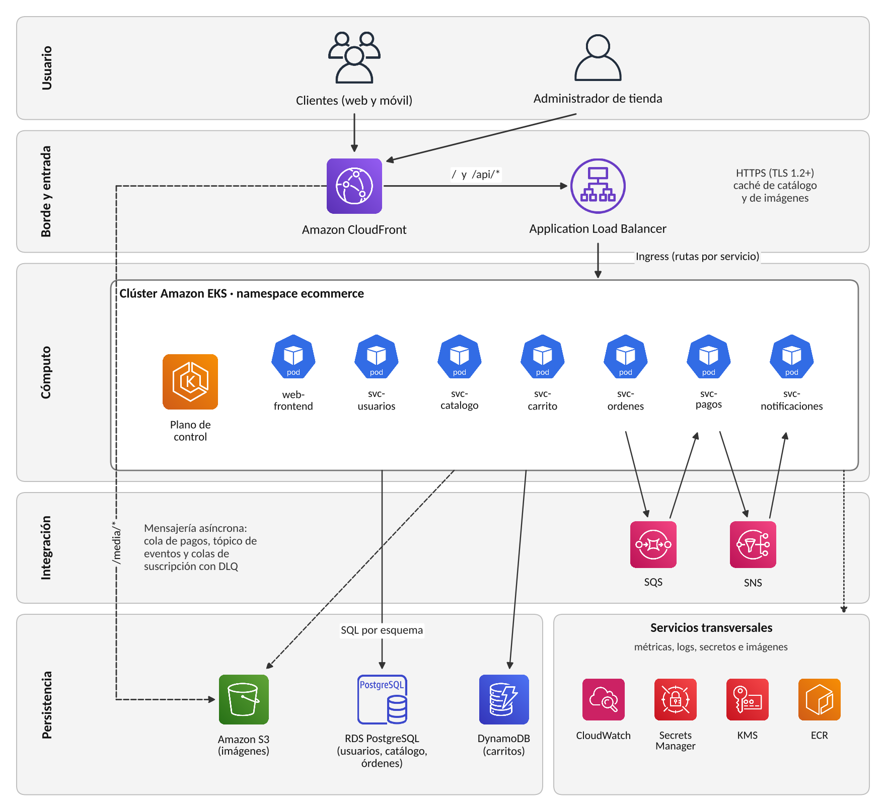

# Huarango Market

Tienda en línea para productores de Ica (piscos, vinos, tejas, chocotejas, dulces y canastas) construida con
microservicios en contenedores y desplegada en Amazon EKS. Es el proyecto final del curso **Servicios Cloud
(100000SI97)** de la UTP, sede Ica: *Plataforma de comercio electrónico escalable con microservicios en
Kubernetes*.

| Integrante | Rol en el proyecto |
|---|---|
| Leonardo Martinez Concha | Arquitecto cloud e ingeniero DevOps: Terraform, EKS, imágenes, scripts e integración continua |
| Kevin Julio Chacaltana Vargas | Redes, seguridad y backend: VPC, security groups, secretos y microservicios |

## Qué resuelve

Las bodegas y dulcerías pequeñas de Ica venden sobre todo en temporada (vendimia, Fiestas Patrias, diciembre)
y por WhatsApp. En esos picos el pedido manual se satura, se vende stock que ya no hay y los pagos se confirman
a mano. Huarango Market reúne a varios productores en un solo catálogo, reserva el stock al momento de pagar,
cobra con una pasarela, avisa al cliente por correo y le da al administrador un panel para despachar.

El objetivo técnico es que la tienda **crezca en los picos sin caerse y sin pagar servidores ociosos el resto
del año**: cada parte del negocio es un servicio independiente que se escala por su cuenta en Kubernetes, y los
datos viven en servicios administrados de AWS.

## Arquitectura



| Capa | Componente | Tecnología | Datos |
|---|---|---|---|
| Frontend | `web-frontend` | React 19 + Vite, servido por nginx sin privilegios | – |
| Backend | `svc-usuarios` (3001) | Node.js 24 + Express 5, JWT RS256 | PostgreSQL, esquema `usuarios` |
| | `svc-catalogo` (3002) | Node.js, subida de imágenes | PostgreSQL `catalogo` + Amazon S3 |
| | `svc-carrito` (3003) | Node.js, AWS SDK v3 | Amazon DynamoDB (TTL de 7 días) |
| | `svc-ordenes` (3004) | Node.js, outbox, idempotencia, circuit breaker | PostgreSQL `ordenes` + SQS |
| | `svc-pagos` (3005) | Worker de cobros (simulado o Culqi) | SQS + SNS |
| | `svc-notificaciones` (3006) | Worker de correos (nodemailer) | SQS |
| Datos | Amazon RDS PostgreSQL 16, DynamoDB, S3 | Servicios administrados | Cifrados en reposo |
| Mensajería | SQS (3 colas con DLQ) y SNS (`eventos-pago`) | Comunicación asíncrona | – |

- **Tipo de nube:** nube pública (AWS, región us-east-1), modelo PaaS/CaaS: Kubernetes administrado (EKS) y
  bases de datos administradas. La infraestructura completa se crea con Terraform.
- **Red:** VPC `10.20.0.0/16` en dos zonas (us-east-1a y us-east-1b) con tres niveles de subred: públicas
  (NAT y, en el APF3, el balanceador), de aplicación (nodos de EKS) y de datos (RDS). Nada fuera de las subredes
  públicas tiene IP pública.
- **Compra:** el checkout reserva el stock, deja la orden en `PENDIENTE_PAGO` y publica el cobro en SQS.
  `svc-pagos` cobra y publica el resultado en SNS, que lo reparte a órdenes y notificaciones.
  Si un servicio se cae, los mensajes esperan en la cola y nada se pierde.

Más diagramas en [`docs/arquitectura`](docs/arquitectura): contenedores (C4), despliegue en AWS y secuencia de
una compra.

## Estructura del repositorio

```
.
├── services/                 Un directorio por componente, cada uno con su Dockerfile y sus pruebas
│   ├── web-frontend/         React + Vite; nginx/default.conf reparte /api/* a cada servicio
│   ├── svc-usuarios/         Registro, login y llaves JWT
│   ├── svc-catalogo/         Productos, imágenes (S3) y reservas de stock
│   ├── svc-carrito/          Carrito en DynamoDB
│   ├── svc-ordenes/          Checkout, estados del pedido y publicación de eventos
│   ├── svc-pagos/            Worker de cobros
│   └── svc-notificaciones/   Worker de correos
├── db/                       Migraciones de PostgreSQL (roles, esquemas, datos iniciales) y migrar.sh
├── infra/                    Terraform
│   ├── modules/              network, security, eks, data, messaging, registry
│   └── envs/lab/             Entorno del Learner Lab (estado remoto en S3)
├── k8s/
│   ├── base/                 Deployments, Services y ServiceAccounts (Kustomize)
│   ├── overlays/lab/         Plantilla con imágenes de ECR y configuración de la cuenta
│   └── jobs/                 Job de migraciones contra RDS
├── scripts/                  Bootstrap, publicación de imágenes, despliegue, verificación y apagado
├── local/                    Configuración de los emuladores para docker compose
├── docs/                     Diagramas y capturas
├── docker-compose.yml        Entorno local completo
└── .github/workflows/ci.yml  Integración continua
```

## Ejecutar en local

Requisitos: Docker Desktop (o Docker Engine con Compose v2).

```bash
cp .env.example .env          # cambia las contraseñas si quieres
docker compose up -d --build
docker compose ps             # todos los servicios deben quedar "running" / "healthy"
```

- Tienda: <http://localhost:8080>
- Correos que envía la tienda: <http://localhost:8025> (Mailpit)
- Administrador: el correo y la contraseña de `ADMIN_EMAIL` y `ADMIN_PASSWORD` en `.env`

Al pagar, la pantalla ofrece dos tarjetas de prueba: `4111 1111 1111 1111` se aprueba y
`4000 0000 0000 0002` se rechaza, para probar el pago fallido. En local, PostgreSQL, DynamoDB Local, ElasticMQ (SQS) y Mailpit reemplazan a los
servicios de AWS; los datos quedan en volúmenes de Docker y sobreviven a `docker compose restart`.
`docker compose down -v` borra todo y vuelve a empezar.

Pruebas unitarias de un servicio: `cd services/svc-ordenes && npm ci && npm test`.

## Desplegar en AWS Academy (Learner Lab)

Herramientas: AWS CLI v2, Terraform 1.10 o superior, kubectl, Docker con buildx, jq y git. En Windows, los
scripts se ejecutan desde WSL2 (Ubuntu).

1. **Credenciales.** Inicia el laboratorio, abre *AWS Details* y copia el bloque de *AWS CLI* en
   `~/.aws/credentials`. Las credenciales cambian en cada sesión.
2. **Estado de Terraform** (solo la primera vez):
   ```bash
   ./scripts/bootstrap-state.sh
   ```
3. **Infraestructura** (unos 20 minutos; EKS es lo que más tarda):
   ```bash
   cp infra/envs/lab/terraform.tfvars.example infra/envs/lab/terraform.tfvars
   # en terraform.tfvars pon tu IP pública: curl -s https://checkip.amazonaws.com
   terraform -chdir=infra/envs/lab apply
   ```
4. **Imágenes** (construye las 7 para amd64 y las sube a ECR con el SHA del commit como etiqueta):
   ```bash
   ./scripts/push-images.sh
   ```
5. **Despliegue en EKS** (crea los secretos desde Secrets Manager, migra RDS y espera a que todo esté listo):
   ```bash
   ./scripts/deploy-k8s.sh
   ```
6. **Abrir la tienda.** En el APF2 la tienda se publica con `port-forward`; el balanceador y CloudFront llegan
   en el APF3.
   ```bash
   kubectl -n ecommerce port-forward svc/web-frontend 8080:8080   # http://localhost:8080
   kubectl -n ecommerce port-forward svc/mailpit 8025:8025        # http://localhost:8025
   ```

Opcional: para enviar correos reales o usar la llave de pruebas de Culqi, carga las credenciales con
`./scripts/cargar-secretos.sh smtp|culqi` y vuelve a ejecutar `deploy-k8s.sh`.

### Verificación del APF2

```bash
./scripts/verificar-apf2.sh | tee evidencias-apf2.txt
```

El script revisa en la cuenta cada punto de la rúbrica y deja la evidencia en texto:

| Criterio | Qué comprueba |
|---|---|
| Red virtual | Subredes públicas y privadas en dos zonas, rutas a IGW y NAT, ningún security group abre SSH, PostgreSQL ni todo el tráfico a `0.0.0.0/0` |
| Cómputo y almacenamiento | Nodos `Ready` sin IP pública, RDS `available` y no pública, DynamoDB y S3 activos, el catálogo responde desde RDS y los datos siguen ahí después de borrar los pods |
| Contenerización | Última imagen de cada repositorio en ECR |

### Apagar al terminar cada sesión

```bash
./scripts/destroy-platform.sh
```

Elimina el clúster, los nodos y el NAT Gateway, que son lo que cobra por hora, y detiene RDS. Conserva los
datos, las imágenes, los secretos y el estado. En la siguiente sesión:

```bash
aws rds start-db-instance --db-instance-identifier huarango-db
terraform -chdir=infra/envs/lab apply
./scripts/deploy-k8s.sh
```

Al cerrar el curso, `./scripts/destroy-all.sh` borra todo.

## Seguridad

- Ninguna contraseña está en el código. En local salen de `.env` (ignorado por git); en AWS, de Secrets
  Manager, y `deploy-k8s.sh` las pasa a Secrets de Kubernetes sin escribirlas en disco.
- La contraseña maestra de RDS la genera y guarda el propio RDS en Secrets Manager.
- Cada servicio entra a PostgreSQL con su propio usuario y solo ve su esquema.
- RDS exige TLS (`rds.force_ssl=1`) y los servicios verifican el certificado (`DB_SSL=verify-full`).
- Los contenedores corren sin root, con el sistema de archivos de solo lectura y sin capacidades extra;
  el namespace aplica el perfil `restricted` de Pod Security.
- Todo se guarda cifrado: RDS y los Secrets de Kubernetes con llaves KMS propias; S3 y DynamoDB con el
  cifrado que administra AWS.

## Integración continua

`.github/workflows/ci.yml` se ejecuta en cada push y pull request a `main`: pruebas de los seis servicios,
compilación del frontend, revisión de los Dockerfiles con hadolint, construcción de las siete imágenes,
validación de `docker-compose.yml`, `terraform fmt` y `terraform validate`, esquema de los manifiestos de
Kubernetes y shellcheck de los scripts.

## Forma de trabajo

- Rama `main` protegida; cada cambio entra por pull request desde una rama `feat/...`, `fix/...` o `docs/...`.
- Mensajes de commit con [Conventional Commits](https://www.conventionalcommits.org/es/):
  `feat(ordenes): reserva de stock con circuit breaker`, `fix(red): ruta de datos sin salida a internet`.
- Antes del commit: `npm test` en el servicio tocado y `terraform fmt -recursive infra` si cambió Terraform.

## Lo que sigue

| Entrega | Alcance |
|---|---|
| APF3 | AWS Load Balancer Controller e Ingress (ALB), CloudFront con HTTPS, HPA y KEDA para escalar con la cola, Prometheus y Grafana, despliegue automático desde GitHub Actions |
| Final | Pruebas de carga, alarmas, costos reales del laboratorio y sustentación |

## Problemas frecuentes

| Síntoma | Solución |
|---|---|
| `terraform apply` falla al crear la llave KMS del clúster | En `terraform.tfvars`, `cifrar_secretos_eks = false` |
| `kubectl` no responde o da *Unauthorized* | Tu IP cambió: actualiza `cidrs_administracion` y aplica de nuevo; o renueva las credenciales del laboratorio |
| Pods en `ImagePullBackOff` | Ejecuta `push-images.sh` y `deploy-k8s.sh` con la misma etiqueta |
| El Job de migraciones falla | RDS está detenida: `aws rds start-db-instance --db-instance-identifier huarango-db` |
| `ExpiredToken` en cualquier comando | La sesión del laboratorio terminó: copia de nuevo las credenciales |
